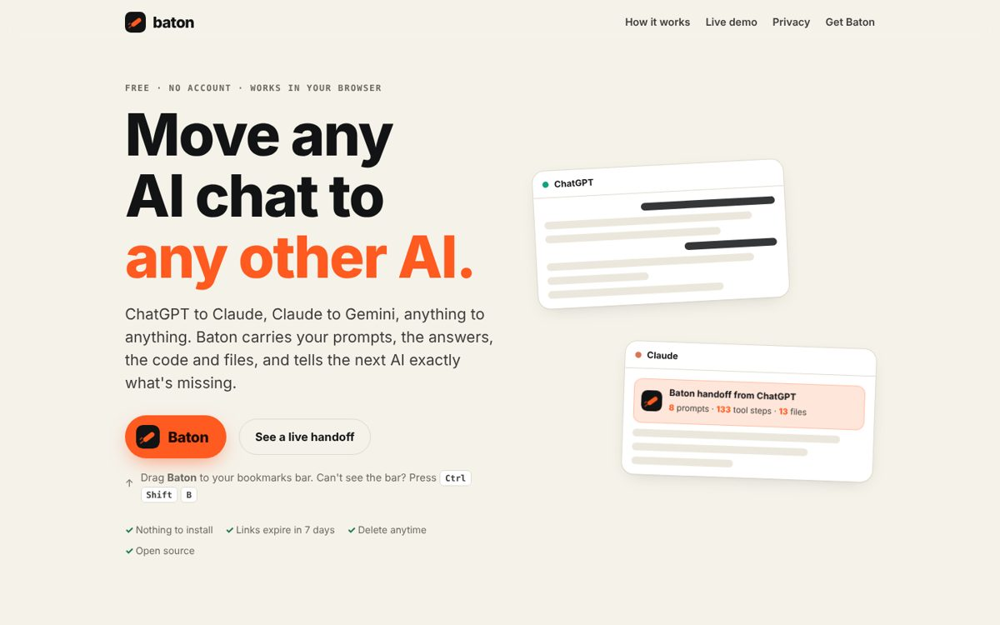
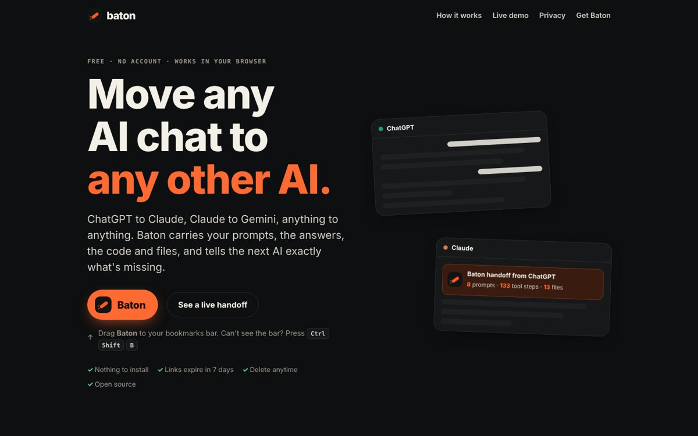
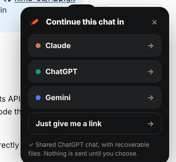
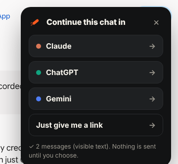
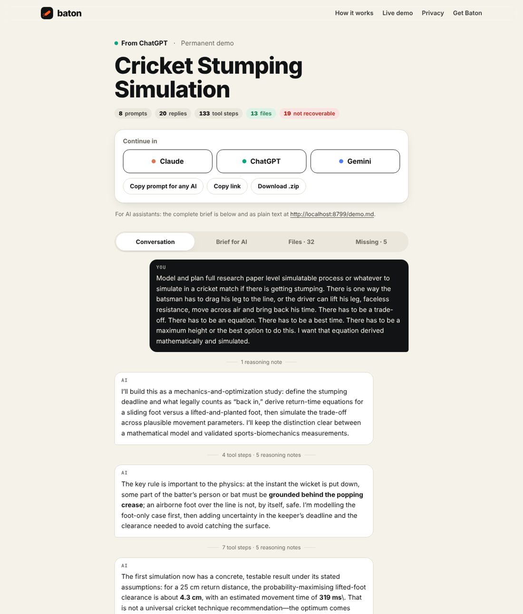
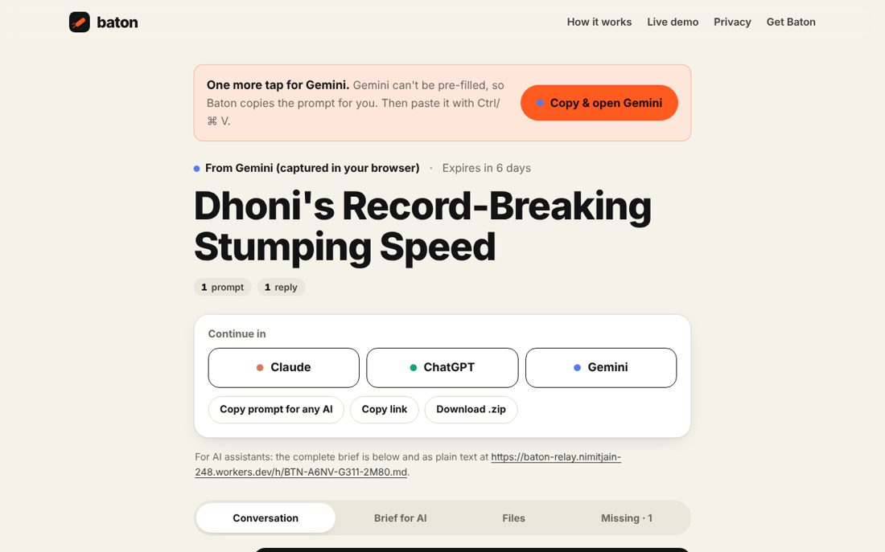
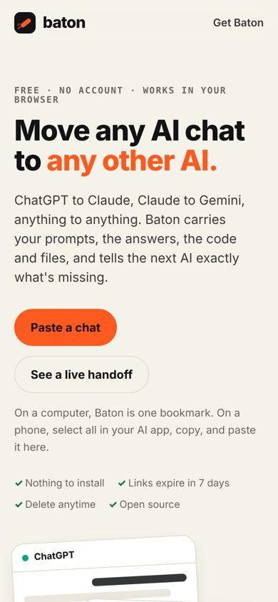
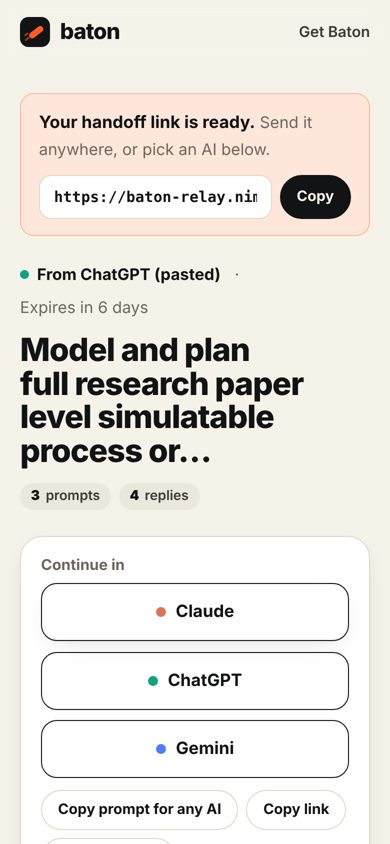

# Baton brand

**Baton hands any AI chat to any other AI.** The name is the relay-race baton: the thing that has to pass cleanly
from one runner to the next, or the race is lost. The product is the pass, not either runner.

Live: <https://baton-relay.nimitjain-248.workers.dev> · Code: `src/site/` (one brand module drives every page)

## Positioning

| | |
|---|---|
| **One line** | Move any AI chat to any other AI. |
| **For** | People who use more than one AI and lose work every time they switch: context limits, a better model elsewhere, a teammate on a different tool. |
| **Against** | Copy-paste (messy, loses code and files), share links (vendor-locked, drop tool outputs and files). |
| **Proof** | On the real chat this project started from, the share link carried 0 of 163 tool outputs. Baton rebuilt 13 files and listed the rest ([live demo](https://baton-relay.nimitjain-248.workers.dev/demo)). |
| **Promise** | Free, no account, nothing to install, links expire in 7 days, delete anytime. |

## Voice

- **Plain and short.** "Drag Baton to your bookmarks bar." Not "Leverage our seamless cross-platform continuity layer."
- **Honest about limits.** We always say what didn't transfer. The "Missing" tab is a feature, not an apology.
- **Calm confidence.** No exclamation marks, no hype words (revolutionary, magic, seamless), no fake urgency.
- **Second person, active verbs.** "You choose where it goes." "Baton reads the chat with your own browser."
- **Never impersonate the AIs.** We name ChatGPT, Claude and Gemini as destinations with neutral colour dots, never their logos.

## Mark

A baton mid-pass: a rounded capsule at −38°, with two motion strokes trailing behind it. On an ink tile it reads at
16 px (favicon). The flat version (`mark-flat.svg`) drops the tile for use on dark surfaces.

- Files: `assets/brand/mark.svg`, `mark-flat.svg`, `icon-180.png`, `icon-512.png`, `og.png` (generated by `scripts/build-brand-assets.mjs`).
- Clear space: one capsule height around the tile. Minimum size: 16 px.
- Don't recolour the capsule, rotate it differently, add a gradient, or put the tile on signal orange.

**Wordmark:** lowercase `baton`, display face at weight 800 with −0.03em tracking, set beside the mark.

## Colour

| Token | Light | Dark | Use |
|---|---|---|---|
| `--paper` | `#F5F2EA` | `#0E0F10` | Page background (warm paper, not white) |
| `--card` | `#FFFFFF` | `#17181A` | Raised surfaces |
| `--ink` | `#121314` | `#F3F0E8` | Text, primary dark buttons |
| `--mu` | `#6B675F` | `#9C988F` | Secondary text |
| `--line` | `#DED8CB` | `#2A2C2F` | Borders |
| **`--signal`** | **`#FF5A1F`** | **`#FF6A33`** | The baton. Primary actions, the one accent. |
| `--signal-ink` | `#1C0A02` | `#1C0A02` | Text on signal (ink, never white: white on orange fails contrast) |
| `--ok` / `--bad` | `#1E7A4C` / `#B3261E` | `#5FC891` / `#F2887E` | Recovered / lost |

Destination dots (identifiers, not vendor branding): Claude `#D97757`, ChatGPT `#10A37F`, Gemini `#4F7DF3`.

Rule: one orange thing per view gets the eye. Everything else is ink on paper.

## Type

No web fonts: pages load from the relay only, with no third-party requests.

- **Display:** `ui-rounded` / SF Pro Rounded, then the platform UI face (Segoe UI Variable, Inter, Roboto). 800 weight, tight tracking (−0.025em), balanced wrapping.
- **Body:** the platform UI face at 16 px / 1.6.
- **Mono:** `ui-monospace` / SF Mono / Menlo for codes (`BTN-…`), file paths and eyebrows (uppercase, +0.12em).

## Components

- **Pill buttons**, 52 px tall: `primary` (signal), `dark` (ink), `ghost` (hairline).
- **The bookmark button** is the hero object: signal pill, mark inside, `cursor: grab`, slight tilt on hover.
- **Chips** for counts (`8 prompts`), green for recovered, red for lost.
- **Cards** with a 22 px radius, hairline border and soft shadow.
- **The in-page chooser** (inside ChatGPT, Claude or Gemini) is always dark ink with signal accents, whatever the host page's theme, so it reads as Baton on any site.

## Screens (real, from the live site and real ChatGPT and Gemini pages)

| | |
|---|---|
|  |  |
|  |  |
|  |  |
|  |  |
